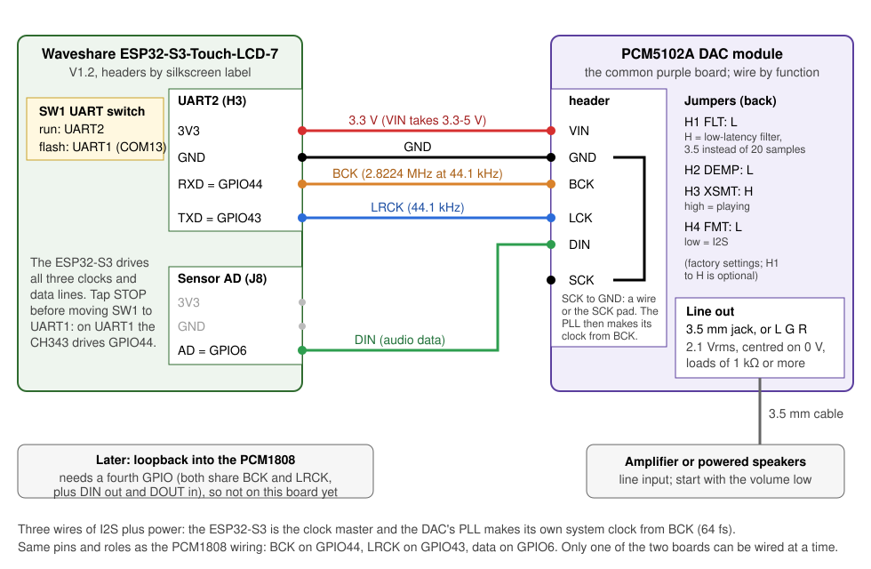

# PCM5102A Test

PlatformIO/ESP-IDF test of the [pcm5102a](../../components/pcm5102a) component on the Waveshare ESP32-S3-Touch-LCD-7. It plays sound through TI's PCM5102A stereo DAC over I2S, a few milliseconds after a tap. That's the wired, low-latency alternative to the AirPlay output the music apps use today, where the delay is 100 ms to 2 s. On screen are:

- four drum pads that play on touch-down
- a test tone or sweep underneath
- the delay from a tap to the line output, and any underruns

This app lives in `apps/pcm5102a_test`. The [root README](../../README.md) lists every app in this repository. It targets the S3 board only (`supported-targets.txt`).

## What it shows

| Row | Contents |
|---|---|
| Status | `PLAYING 44.1 kHz` while the DAC runs. `SET SW1 TO UART2` means GPIO44 reads high, so the UART switch is probably on UART1 (see below). `STOPPED` after you tap STOP. `I2S: ...` if the transmitter wouldn't start. |
| Clocks | BCK and LRCK frequencies. BCK is 64 × the sample rate. |
| Queue | DMA buffers × frames per buffer and how long they take to play, and the DAC filter's delay (`NORMAL`, 20 samples, or `LOW`, 3.5 samples). |
| Last tap | **PICKUP**: from the touch task reporting the tap to the audio task starting the sound, at most one block. **OUT**: the longest wait in the DMA queue plus the filter delay. Their sum is the delay from the tap to the line output. The GT911 panel adds its own scan time, about 5-10 ms, before the tap is reported. |
| Underruns | DMA buffers that played silence because the audio task was late. It should stay at 0. If it climbs at `BUF 32`, use a larger buffer. |
| Pads | **KICK**, **SNARE**, **HAT** and **BEEP 1k** (40 ms of 1 kHz with a sharp start, for timing). Each finger is its own hit, at -6 dBFS. |
| Buttons | **TONE**: off, 440 Hz, 1 kHz, or a 20 Hz-20 kHz sweep over 10 s. **dB**: tone level, -20/-12/-6/0 dBFS. **L + R / LEFT / RIGHT**: which outputs play, for checking the channels. **BUF**: frames per DMA buffer, 32/64/128/256; there are always 3 buffers. **kHz**: 44.1/48/96 kHz. **STOP / START**: stops the I2S clocks and makes the three pins inputs again. |

At 44.1 kHz with `BUF 64`, the queue is 4.35 ms and the normal filter 0.45 ms. The status rows show the exact numbers for the current settings.

To measure the whole delay, put a microphone near your finger and the speaker. Record the tap's click and the BEEP pad, and measure the gap between them in an audio editor.

## Wiring



Only three GPIOs reach the Waveshare board's headers that the display, touch, SD card, USB/CAN and RS485 don't already use. The PCM5102A needs only three signals, because its PLL makes its own system clock from BCK when SCK is tied to GND. The ESP32-S3 is the clock master and drives all three pins. The pins and roles are the same as the [PCM1808's](../pcm1808_test) (BCK on GPIO44, LRCK on GPIO43, data on GPIO6), but only one of the two boards can be wired at a time.

| PCM5102A module | Wire | Waveshare header | GPIO |
|---|---|---|---|
| VIN | 3.3 V (the module takes 3.3-5 V) | UART2 (H3) 3V3 | |
| GND | direct | UART2 (H3) GND | GND |
| BCK | direct | UART2 (H3) RXD | 44 |
| LCK (LRCK) | direct | UART2 (H3) TXD | 43 |
| DIN | direct | Sensor AD (J8) AD | 6 |
| SCK | to the module's own GND: a short wire, or bridge the SCK pad | | |

- **UART switch (SW1):** the UART2 header and the CH343 (COM13) share GPIO43/44, and SW1 picks one. Set it to **UART1** to flash and to see the boot log. Set it to **UART2** to play. The serial log stops once the DAC starts.
- **Tap STOP before moving SW1 to UART1.** This app drives GPIO44 as BCK. On UART1, the CH343's TXD drives the same pin, so the two outputs would fight. Before starting, the app reads GPIO44 with a pull-down: the CH343 holds it high, an unconnected header or the DAC's input reads low. So it starts on its own only once SW1 is on UART2. If your DAC board pulls BCK up and the app keeps showing `SET SW1 TO UART2` with SW1 set right, tap START.
- **GPIO43 at boot:** the ROM, the bootloader and the launcher send their logs on GPIO43, so the DAC sees noise on LRCK before the app starts. With no BCK, the DAC stays muted, so nothing is heard and no resistor is needed: a DAC input only listens.

### DAC module settings

These are for the common purple PCM5102A module (labels VIN, GND, LCK, DIN, BCK, SCK). For another board, wire by function and set the pins the same way.

| Pin | Setting | Meaning |
|---|---|---|
| SCK | to GND | 3-wire I2S: the PLL makes the system clock from BCK. If SCK floats, the DAC may never start. |
| H1 FLT | L (factory); **H** for the lowest latency | Low = normal filter (20 samples); high = low-latency filter (3.5 samples). If you bridge H1 to H, set `DAC_LOW_LATENCY_FILTER` to 1 in `main/main.c` so the readout matches. |
| H2 DEMP | L | No de-emphasis |
| H3 XSMT | H | Playing (low mutes) |
| H4 FMT | L | I2S, which is what the ESP32 sends |

### Output

The line output gives 2.1 Vrms full scale into 1 kΩ or more. Connect it to an amplifier's or powered speakers' line input, and start with the volume low: a 0 dB tone is loud. Headphones are a lower load than the DAC is rated for.

## Build and flash

```powershell
cd apps\pcm5102a_test
$pio = "$env:USERPROFILE\.platformio\penv\Scripts\pio.exe"
& $pio run -e esp32s3
```

The image is `%USERPROFILE%\.platformio\cyd-pcm5102a-build\esp32s3\firmware.bin`.

- **As a launcher image:** when a change to this folder is merged into `main`, CI publishes `firmware-esp32s3.bin` on the release tagged `pcm5102a_test`, and the launcher lists it.
- **Over USB into a launcher slot:** see the [launcher README](../../launcher/README.md). The board is on COM13 with SW1 on UART1.

## Changelog

### 1.0 (2026-11-14)

- First version: four drum pads played on touch-down, a test tone and sweep, and readouts of the clocks, the tap-to-output delay and underruns. The PCM5102A runs as a 3-wire I2S slave on GPIO44/43/6, with adjustable DMA buffers (32-256 frames) and sample rate (44.1/48/96 kHz).
